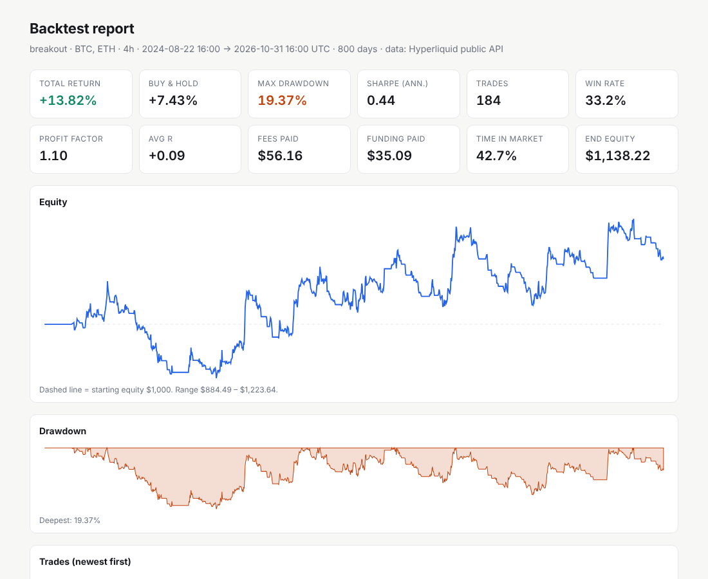
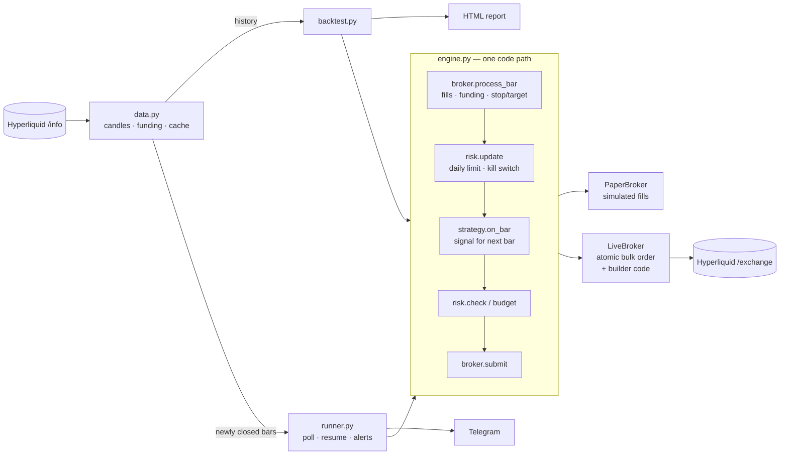

# hyperliquid-orb — risk-managed trading bot for Hyperliquid perpetuals

*Named for the yeouiju, the orb of Korean myth that an imugi must earn before it becomes a dragon. Not an opening-range-breakout bot.*

Backtest, paper-trade and live-trade Hyperliquid perps with **one shared engine**, so what you test is exactly what runs.

```
orb backtest                      # real Hyperliquid candles + funding, HTML report
orb sweep --grid stop_atr=1.5,2,3  # catches curve-fit settings before your money does
orb paper                         # live data, simulated fills, Telegram alerts
orb live --confirm-live           # real orders: entry + stop + target in one atomic request
```



*Default breakout strategy, BTC + ETH, 4h, ~800 days of Hyperliquid data: +13.8% vs +7.4% buy & hold, with a 19% max drawdown vs 60% for buy & hold. Details in [Example results](#example-results).*

---

## What makes it different

| Problem with typical bot code | How orb handles it |
|---|---|
| Backtest and live use different code, so live never matches the test | Backtest, paper and live all push closed bars through the same `Engine`. A test proves the paper loop reproduces the backtest **trade for trade**. |
| Look-ahead bias (signal and fill on the same bar) | Strategies only see closed bars; signals fill at the **next bar's open**. A test proves future data cannot change past trades. |
| Optimistic fills | Stop assumed hit before target when both trade in one bar; gaps through the stop fill at the open; taker fees both sides; slippage; **hourly funding** charged from Hyperliquid's real funding history. |
| "Position size = 10% of balance" | Fixed-fractional risk: size = (equity × risk %) / stop distance, capped by max leverage. Gaps change size, never risk. |
| Naked positions if the bot dies after entry | Live entry, take-profit and stop are sent as **one atomic `bulk_orders` call** (`normalTpsl`). Exits are reduce-only, so they can never flip or enlarge a position. |
| No protection from a bad day | Daily loss limit (UTC), max open positions, one position per coin, and a **drawdown kill switch** that flattens and halts until a human resets it. |
| Restarts re-trade old bars or forget positions | Crash-safe state (atomic write + rename). On restart it resumes from the last processed bar; on live start it reconciles with the exchange and refuses to touch positions it didn't open. |
| Curve-fit parameters | `orb sweep` scores every combination in-sample, then runs the same combination on unseen out-of-sample data. |
| Secrets in config files | Keys only from env / `.env`. Live mode expects a Hyperliquid **API wallet** (can trade, cannot withdraw). |

## Architecture



```
src/orb/
  config.py        typed YAML config (pydantic), validated limits
  data.py          Hyperliquid info API: pagination, retries/backoff, CSV cache
  indicators.py    streaming EMA / ATR / rolling window (O(1) per bar)
  strategies/      Strategy interface + ema_retest + breakout
  risk.py          sizing, limits, daily loss, kill switch
  broker/paper.py  conservative fill simulator (backtest + paper)
  broker/live.py   Hyperliquid SDK execution, reconciliation, builder codes
  engine.py        the shared bar-by-bar pipeline
  backtest.py      replay + in/out-of-sample sweep
  metrics.py       return, drawdown, Sharpe, profit factor, R-multiples
  report.py        self-contained HTML report (light/dark, no external assets)
  runner.py        real-time loop: warm-up, resume, error backoff, alerts
  state.py         crash-safe JSON state
  cli.py           command line
tests/             55 tests, 93% coverage, no network needed
```

## Quick start

```bash
python -m venv .venv && source .venv/bin/activate
pip install -e ".[dev]"
cp config.example.yaml config.yaml
orb backtest --report reports/backtest.html
open reports/backtest.html
```

No API key is needed for `fetch`, `backtest`, `sweep` or `paper`.

### Paper trading

```bash
orb paper           # runs until Ctrl-C; state in state/state.json
orb status          # equity, positions, recent events
```

Telegram alerts: set `notifications.telegram: true`, then `TELEGRAM_BOT_TOKEN` and `TELEGRAM_CHAT_ID` in `.env`.

### Live trading

1. Create an **API wallet** in Hyperliquid (Settings → API). It can place orders but cannot withdraw.
2. Put `HL_PRIVATE_KEY` (the API wallet key) and `HL_ACCOUNT_ADDRESS` (your main account) in `.env`.
3. Start on testnet: `network: testnet` in `config.yaml`.
4. `orb live --confirm-live`

Each entry is one request containing an IOC entry (bounded slippage), a reduce-only take-profit trigger and a reduce-only stop trigger.

### Builder codes (earn fees on routed volume)

Hyperliquid lets any app attach a **builder code** to orders and earn a per-fill fee (cap 0.1% on perps).
If you run this bot for other people, each fill can pay your builder address:

```yaml
builder:
  enabled: true
  address: "0xYourBuilderAddress"
  fee_tenths_bps: 10      # 1 bp = 0.01%
```

The trading account approves it once: `orb approve-builder --confirm-live`.

## Commands

| Command | What it does |
|---|---|
| `orb fetch [--days 800]` | Download candles + funding into `data/` (incremental) |
| `orb backtest [--offline] [--report f.html] [--json f.json]` | Backtest on cached or fresh data |
| `orb sweep --grid k=v1,v2 [--grid ...] [--split 0.7]` | In-sample/out-of-sample parameter grid |
| `orb paper [--once]` | Paper trade on live data |
| `orb live --confirm-live [--once]` | Live trade |
| `orb approve-builder --confirm-live` | Approve the configured builder fee |
| `orb status` | Show saved state |

## Adding a strategy

```python
from orb.strategies.base import Strategy, BarContext
from orb.models import Signal, Side

class MyStrategy(Strategy):
    name = "my_strategy"
    defaults = {"length": 20}

    def new_state(self): ...            # per-coin indicator objects
    def warmup_bars(self): return 25
    def on_bar(self, coin, bar, ctx: BarContext) -> Signal | None:
        ...                              # closed bar in, optional signal out
```

Register it in `strategies/__init__.py`. Risk, sizing, execution, reports and alerts come for free.

## Example results

Bundled `breakout` strategy with its **default parameters (fixed before testing)**. BTC + ETH, 4h bars, $1,000 start,
1% risk per trade, taker fees, slippage and real hourly funding included. Data: Hyperliquid, to 2026-10-31.

| Window | Strategy | Buy & hold | Strategy max drawdown | Buy & hold max drawdown | Trades |
|---|---|---|---|---|---|
| ~800 days (all available) | **+13.8%** | +7.4% | **19.4%** | 59.7% | 184 |
| 500 days | **+5.2%** | −18.1% | **14.7%** | 61.7% | 105 |
| 300 days | −4.1% | −21.6% | **12.4%** | 46.8% | 55 |

It beat buy & hold in every window, with roughly a third of the drawdown, and lost far less in the falling market of the
last 300 days. The edge is modest (profit factor about 1.1), so treat the strategy as a sensible, well-behaved example
rather than a money machine. The bot is the product; plug in your own strategy.

**Overfitting check.** `orb sweep` on the same data shows why the default parameters were not re-tuned: the
in-sample "best" combination (lookback 24, stop 1.5 ATR) made +62% in-sample and **lost 20% out of sample**. The sweep
exists to catch exactly that before it reaches a live account.

Past results do not predict future results. Not financial advice.

## Testing

```bash
pytest --cov=orb      # 55 tests, ~2 s, offline
ruff check src tests
```

Highlights: no look-ahead (future bars cannot change past trades), paper loop == backtest trade-for-trade,
restart resumes without re-processing, cache backfills without losing history, kill switch flattens and halts, live orders are atomic/reduce-only with
the builder field, retry/backoff and pagination against a fake API, fee/funding/slippage arithmetic.

## Deploy

```bash
docker build -t hyperliquid-orb .
docker run -d --restart unless-stopped -v $PWD/config.yaml:/app/config.yaml \
  -v $PWD/state:/app/state --env-file .env hyperliquid-orb paper
```

## Limitations

- Bars are processed on close (1m to 1d); this is not a high-frequency or market-making bot.
- Hyperliquid serves at most the last 5,000 bars per interval; longer history needs another source.
- Live realised PnL is taken from exchange fills (closedPnl − fees); funding is reconciled by the exchange, not the bot.
- The live broker is unit-tested against a mocked SDK. Run on testnet before mainnet.

MIT licence.
